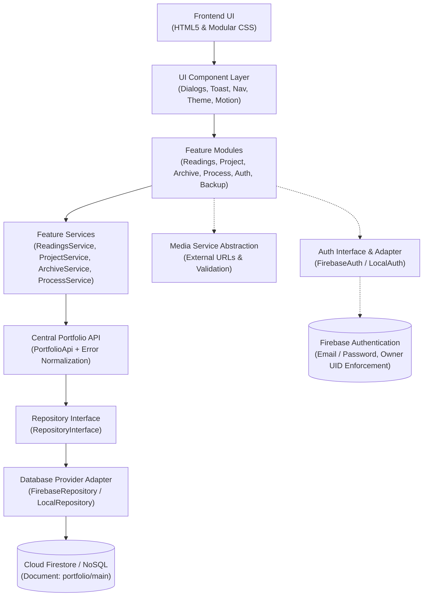

# Deepak — Digital Humanities Portfolio (Firebase Spark Edition)

> **Course**: ENG101-2B · Introduction to Digital Humanities  
> **Student**: Deepak (2633115) · BA English, Semester II, 2026–27  
> **Institution**: CHRIST (Deemed to be University), Department of English and Cultural Studies

---

## 1. Project Architecture

This project is an existing, completed Digital Humanities portfolio migrated to a 100% free-tier backend powered by **Firebase Spark (Free Plan)** using **Cloud Firestore** and **Firebase Authentication**.

The codebase enforces a strict **independent layered architecture**: visual styling, feature modules, service coordination, and cloud infrastructure are completely decoupled. Neither the UI components nor the feature modules import the Firebase SDK directly. All interactions flow through abstracted interfaces, ensuring the database or authentication provider can be replaced in the future without rewriting the frontend.



### Key Architectural Principles
- **Visual Invariance**: Typography, color palette, animations, mobile responsiveness, and layout match the original portfolio 100%.
- **Zero Framework / Bundler Overhead**: Pure vanilla JavaScript (ES modules), HTML5, and CSS3. No Webpack, Vite, or React needed.
- **Provider Independence**: Feature modules interact solely through `PortfolioApi` and `AuthService`. Only adapters inside `src/backend/` know about Firebase.
- **External Media Only**: No binary blobs or uploaded files are stored in Firebase. External HTTPS media links are validated and used exclusively, avoiding Firebase Storage or paid bandwidth.
- **Serverless Free-Tier Security**: Security is enforced by Google's servers via **Firestore Security Rules**. Client-side checks are for UI visibility only.
- **Refresh-Based Data Model**: Data loads on initial page view and refreshes cleanly on page reload or owner saves. No costly realtime WebSocket listeners, polling loops, or Firebase Realtime Database connections.

---

## 2. Project Folder Structure

```
port/
├── backup/
│   └── Deepak_2633115.original.html        # Preserved original HTML baseline backup
├── firebase/
│   └── firestore.rules                     # Cloud Firestore Security Rules (Owner-only writes)
├── legacy/
│   └── supabase/                           # Archived legacy Supabase files (for reference)
│       ├── database/
│       ├── supabase-auth.js
│       └── supabase-repository.js
├── src/
│   ├── api/
│   │   └── portfolio-api.js                # Central API contract & unified error normalization
│   ├── backend/
│   │   ├── auth/
│   │   │   ├── auth-interface.js           # Abstract AuthInterface contract
│   │   │   ├── firebase/
│   │   │   │   └── firebase-auth.js        # Firebase Authentication Modular Adapter
│   │   │   └── local/
│   │   │       └── local-auth.js           # Offline / mock testing Auth adapter
│   │   ├── database/
│   │   │   ├── repository-interface.js     # Abstract RepositoryInterface contract
│   │   │   ├── firebase/
│   │   │   │   └── firebase-repository.js  # Cloud Firestore NoSQL repository adapter
│   │   │   └── local/
│   │   │       └── local-repository.js     # In-memory / fallback repository adapter
│   │   ├── firebase/
│   │   │   └── firebase-client.js          # Firebase SDK initialization & instance manager
│   │   └── backend-factory.js              # Provider factory based on application config
│   ├── config/
│   │   ├── app-config.js                   # Application configuration & validation
│   │   └── index.js                        # Configuration exports
│   ├── constants/
│   │   ├── course-units.js                 # Course Units 1–4 syllabus metadata
│   │   ├── readings-data.js                # 9 assigned reading bibliographic records
│   │   └── milestones-data.js              # 2026–27 course calendar milestones
│   ├── features/
│   │   ├── archive/                        # Digital archive (Grid, card details, CRUD)
│   │   │   ├── archive-module.js
│   │   │   └── archive-service.js
│   │   ├── auth/                           # Owner authentication & status modal
│   │   │   ├── auth-modal.js
│   │   │   └── auth-service.js
│   │   ├── backup/                         # JSON export/import & safe migration tool
│   │   │   ├── backup-module.js
│   │   │   └── migration-tool.js
│   │   ├── process/                        # Process journal, sources, declarations
│   │   │   ├── process-module.js
│   │   │   └── process-service.js
│   │   ├── project/                        # Bengaluru field project proposal workspace
│   │   │   ├── project-module.js
│   │   │   └── project-service.js
│   │   └── readings/                       # Reading journals, search, filters
│   │       ├── readings-module.js
│   │       └── readings-service.js
│   ├── services/
│   │   ├── error-service.js                # AppError and ErrorTypes classification
│   │   └── media-service.js                # External media URL validation & typing
│   ├── styles/                             # Modular stylesheets (Base, typography, dialogs, etc.)
│   ├── ui/                                 # UI utilities (Dialog, toast, navigation, theme, motion)
│   ├── utils/                              # Helpers (Normalize, HTML escape, blob download)
│   └── app.js                              # Main application orchestrator
├── tests/
│   ├── auth-interface.test.js              # Auth contract compliance tests
│   ├── firebase.test.js                    # Firebase Auth, Firestore Repo, Role & Error tests
│   ├── media-service.test.js               # External media URL validation tests
│   ├── migration.test.js                   # Migration preview, base64 detection tests
│   ├── normalization.test.js               # Schema validation & normalizer tests
│   ├── portfolio-api.test.js               # Central API operations tests
│   ├── repository-interface.test.js        # Repository contract compliance tests
│   └── run-all-tests.js                    # Unified test runner
├── Deepak_2633115.html                     # Primary HTML portfolio file
├── index.html                              # Standard web root file
├── env.example.js                          # Public configuration template (Firebase)
├── firebase.json                           # Firebase Hosting and Firestore rules configuration
├── netlify.toml                            # Netlify static hosting deployment config
├── server.js                               # Zero-dependency local Node.js development server
└── README.md                               # Complete documentation
```

---

## 3. What Each Module Does

| Module | Location | Responsibility |
|---|---|---|
| **Readings** | `src/features/readings/` | Renders reading rows, Units 1–4 tabs, live search, unit filter pills, reading modal with 4 tabs (annotation, analysis, notes, summary), and owner editing dialog. |
| **Project** | `src/features/project/` | Displays the Bengaluru field project workspace, status pill, research stages (CIA I, Fieldwork, CIA III), proposal view modal, and proposal edit form. |
| **Archive** | `src/features/archive/` | Displays archive grid, empty illustration, record details, external media validation, add record form, edit record form, and record deletion. |
| **Process** | `src/features/process/` | Manages the process journal (meeting logs, contributions, reflection), bibliographic shelf, semester milestones, and academic declaration. |
| **Auth** | `src/features/auth/` | Provides owner login modal, owner status inspection, session restoration, and guards all edit actions so only the owner UID can modify content. |
| **Backup** | `src/features/backup/` | Handles JSON backup export, JSON backup import with schema validation, and complete portable HTML snapshot download. |
| **Migration** | `src/features/backup/` | One-time owner migration tool: reads legacy `deepak-dh-2633115-v1` localStorage, previews entries, reports base64 images, warns on cloud conflict, and verifies sync. |
| **Media Service** | `src/services/` | Validates URLs, resolves media types (image, audio, video, document, webpage), rejects unsafe schemes (e.g. `javascript:`), and enforces `rel="noopener noreferrer"`. |

---

## 4. Cloud Firestore Data Structure

To ensure zero downtime, backward compatibility, and avoid splitting data across multiple network round-trips, Firestore stores the normalized portfolio in a single document:

- **Collection**: `portfolio`
- **Document ID**: `main`

### Document Fields
```json
{
  "schemaVersion": 1,
  "updatedAt": 1700000000000,
  "data": {
    "readings": {
      "kirschenbaum": {
        "annotation": "https://example.com/scan.pdf",
        "analysis": "Student analysis of Kirschenbaum...",
        "notes": "https://example.com/notes.pdf",
        "summary": "Summary of DH in English departments..."
      }
    },
    "project": {
      "title": "Living Archives of Bengaluru",
      "site": "Malleswaram",
      "question": "How do heritage streetscapes transform in digital memory?",
      "description": "...",
      "rationale": "...",
      "concepts": "...",
      "method": "...",
      "variables": "...",
      "ethics": "...",
      "objectives": "...",
      "outcomes": "...",
      "team": "Deepak and group members",
      "status": "In Progress"
    },
    "archive": [
      {
        "id": "rec-1700000001",
        "title": "Conservancy Lane Photograph",
        "type": "Photograph",
        "date": "2026-11-20",
        "location": "8th Cross, Malleswaram",
        "creator": "Deepak",
        "source": "https://images.example.com/lane.jpg",
        "permission": "Attribution-NonCommercial 4.0",
        "description": "Field documentation of historic alleyway.",
        "interpretation": "Physical layout reflecting colonial planning.",
        "image": "https://images.example.com/lane.jpg"
      }
    ],
    "process": {
      "log": "Initial site survey completed on Nov 15.",
      "contribution": "Field photography, archive curation, reading notes.",
      "reflection": "Digital tools allow participatory documentation of urban history.",
      "sources": "Referenced citations from course syllabus.",
      "acknowledgements": "Website design and interface were created with assistance from ChatGPT. Reading analyses, learning summaries, project findings, and personal reflections must be added by Deepak. This declaration should be reviewed before academic submission."
    }
  }
}
```

---

## 5. 10-Step Setup Guide: Setting Up Firebase Spark

Follow these step-by-step instructions to configure your free Firebase backend.

### Step 1: Create a Firebase Project
1. Go to the [Firebase Console](https://console.firebase.google.com/) and sign in with your Google account.
2. Click **Add project** (or **Create a project**).
3. Name your project (e.g., `deepak-dh-portfolio`).
4. Google Analytics is optional (you may disable it to keep the project minimal).
5. Ensure your project is on the **Spark plan** (Free). *Never upgrade to Blaze or add billing credentials.*

### Step 2: Register a Web Application
1. In the Project Overview page, click the **Web icon** (`</>`) to add a web app.
2. Enter an App nickname (e.g., `portfolio-web`).
3. You do not need to check "Firebase Hosting" at this moment.
4. Click **Register app**.
5. Firebase will display your `firebaseConfig` object containing:
   - `apiKey`
   - `authDomain`
   - `projectId`
   - `appId`
   - `messagingSenderId`
6. Keep this tab open or save these values.

### Step 3: Enable Firebase Authentication
1. In the Firebase Console left menu, navigate to **Build** -> **Authentication**.
2. Click **Get started**.
3. Under the **Sign-in method** tab, click **Email/Password**.
4. Enable the first toggle (**Email/Password**). *Leave Email link (passwordless sign-in) disabled.*
5. Click **Save**.
6. Switch to the **Users** tab.
7. Click **Add user** to manually create your portfolio owner account.
8. Enter your chosen owner email and a secure password. Click **Add user**.
9. *Important*: Public visitor registration is disabled in the portfolio UI. Only accounts created here in the console can ever authenticate.

### Step 4: Obtain Owner UID
1. In the **Authentication -> Users** table, locate your newly created owner account.
2. Copy the value under the **User UID** column (a string of alphanumeric characters, e.g., `v7XkQ9L2mP0...`).
3. You will insert this UID into two places:
   - Frontend configuration (`env.js` -> `FIREBASE_OWNER_UID`)
   - Firestore Security Rules (`firebase/firestore.rules` -> `<FIREBASE_OWNER_UID>`)

### Step 5: Create Cloud Firestore Database
1. In the left menu, navigate to **Build** -> **Firestore Database**.
2. Click **Create database**.
3. Database mode: Choose **Native mode** (Standard).
4. Choose a Cloud Firestore location (e.g., `asia-south1` for Mumbai, or `us-central1`).
5. Security rules: Choose **Start in production mode** (all reads/writes denied by default).
6. Click **Create**.

### Step 6: Publish Security Rules
1. In Firestore Database, click the **Rules** tab.
2. Open the local file `firebase/firestore.rules` in your code editor.
3. Replace `<FIREBASE_OWNER_UID>` with your actual owner UID copied in Step 4.
4. Paste the complete rules into the Firebase Console Rules editor:
   ```javascript
   rules_version = '2';
   service cloud.firestore {
     match /databases/{database}/documents {
       match /portfolio/{document=main} {
         allow get: if true;
         allow list: if false;
         allow create, update: if request.auth != null 
                               && request.auth.uid == 'PASTE_YOUR_OWNER_UID_HERE';
         allow delete: if false;
       }
       match /{document=**} {
         allow read, write: if false;
       }
     }
   }
   ```
5. Click **Publish**. Your cloud database is now locked down: public visitors have read-only access to `portfolio/main`, and only your designated UID can write.

### Step 7: Initialize Portfolio Data
You do not need to create documents manually in the console:
1. When you run the portfolio website (see Step 9) and log in with your owner account, your browser will read any existing local data.
2. Open **Owner Status** -> **Local data migration tool** to push your baseline data directly into `portfolio/main`.
3. Alternatively, making any initial edit in the owner workspace and clicking **Save** will atomically create `portfolio/main`.

### Step 8: Configure the Website
1. In the root of your project, copy `env.example.js` to create `env.js`:
   ```bash
   cp env.example.js env.js
   ```
2. Fill in the parameters with your Firebase Web configuration from Step 2 and your owner UID from Step 4:
   ```javascript
   window.__ENV__ = {
     APP_NAME: 'Deepak · Digital Humanities Portfolio',
     NODE_ENV: 'production',
     BACKEND_PROVIDER: 'firebase',
     AUTH_PROVIDER: 'firebase',
     DATABASE_PROVIDER: 'firebase',

     FIREBASE_API_KEY: 'AIzaSyA...',
     FIREBASE_AUTH_DOMAIN: 'deepak-dh-portfolio.firebaseapp.com',
     FIREBASE_PROJECT_ID: 'deepak-dh-portfolio',
     FIREBASE_APP_ID: '1:1234567890:web:abcdef123456',
     FIREBASE_MESSAGING_SENDER_ID: '1234567890',

     FIREBASE_OWNER_UID: 'v7XkQ9L2mP0...'
   };
   ```
3. *Note*: Client configuration values in `env.js` are public browser parameters. Real security is enforced on Google's servers by your Firestore Security Rules.

### Step 9: Run Locally
Start the zero-dependency local server:
```bash
node server.js
```
Open [http://localhost:3000](http://localhost:3000) in your web browser.

Verify that:
- The website loads with dark/light theme and responsive navigation.
- All 9 readings, Bangalore field project, digital archive, and milestones render cleanly.
- Clicking **Edit portfolio** -> **Owner Sign In** opens the authentication modal.

### Step 10: Deploy Using Free-Tier Hosting

#### Option A: Firebase Hosting (Recommended, 100% Free)
1. Install Firebase CLI (if not already installed):
   ```bash
   npm install -g firebase-tools
   ```
2. Log in and initialize:
   ```bash
   firebase login
   firebase init hosting
   ```
   - Select your existing Firebase project.
   - Public directory: `.` (current directory).
   - Configure as single-page app: `No`.
   - Set up automatic builds with GitHub: `No`.
   - Overwrite index.html: `No`.
3. Deploy:
   ```bash
   firebase deploy --only hosting
   ```
4. Firebase Hosting provides a free `https://<project-id>.web.app` URL with free SSL certificate.

#### Option B: Netlify Static Hosting (100% Free)
The repository includes `netlify.toml` pre-configured with secure HTTP headers.
1. Push this repository to GitHub or GitLab.
2. Sign in to [Netlify](https://www.netlify.com/) and click **Add new site** -> **Import an existing project**.
3. Set Publish directory to `.` (root). Leave build command blank.
4. Deploy site.

---

## 6. How to Add a New Feature Module

The modular architecture makes adding new features clean and non-invasive:

1. **Update Data Normalizer** (`src/utils/normalize.js`):
   Define the new data key in the schema validator:
   ```javascript
   const fieldWorkNotes = Array.isArray(raw.fieldWorkNotes) ? raw.fieldWorkNotes : [];
   return { ...data, fieldWorkNotes };
   ```
2. **Add API Operations** (`src/api/portfolio-api.js`):
   ```javascript
   async getFieldWorkNotes() {
     const portfolio = await this.getPortfolio();
     return portfolio.fieldWorkNotes || [];
   }
   async addFieldWorkNote(note) {
     const portfolio = await this.getPortfolio();
     portfolio.fieldWorkNotes.push(note);
     return await this.updatePortfolio(portfolio);
   }
   ```
3. **Create Feature Service & Module** (`src/features/fieldwork/`):
   - `fieldwork-service.js`: Calls `portfolioApi`.
   - `fieldwork-module.js`: Renders DOM elements, binds event listeners, handles dialogs.
4. **Register in `src/app.js`**:
   Instantiate the service and module in `PortfolioApp.start()`.

---

## 7. How to Replace the Database or Auth Provider

Because all features communicate through `RepositoryInterface` and `AuthInterface`, you can switch backend providers in the future without changing any UI code:

### Replacing Database Adapter:
1. Create `src/backend/database/<new-provider>/<new>-repository.js` extending `RepositoryInterface`.
2. Implement `getPortfolio()`, `updatePortfolio()`, `getRecord()`, `createRecord()`, `updateRecord()`, and `deleteRecord()`.
3. Register your class in `src/backend/backend-factory.js`.

### Replacing Auth Adapter:
1. Create `src/backend/auth/<new-provider>/<new>-auth.js` extending `AuthInterface`.
2. Implement `signIn()`, `signOut()`, `getCurrentUser()`, `getSession()`, `isAuthenticated()`, `isOwner()`, and `onAuthStateChange()`.
3. Register your class in `src/backend/backend-factory.js`.

---

## 8. Data Migration & Recovery

### Migrating Existing Local Browser Data
If you previously used the local browser version of the portfolio (`deepak-dh-2633115-v1`):
1. Sign in as owner using the **Edit portfolio** button.
2. Open **Owner Status** -> **Local data migration tool**.
3. The migration tool:
   - Reads and validates your local data.
   - Automatically downloads a `pre_migration_backup_*.json` file to your computer.
   - Inspects Cloud Firestore to check if data already exists.
   - If cloud data already exists, displays an explicit conflict warning requiring separate confirmation.
   - Reports any base64 images requiring external URL replacement.
   - Writes to Firestore and verifies by reading back from the cloud.
   - Safely preserves your local `localStorage` copy intact.

### How to Back Up Your Data
- **Website JSON Backup**: Click **Edit portfolio** -> **Export data** to download a full JSON snapshot.
- **Standalone HTML Snapshot**: Click **Download HTML** in the footer to download a portable offline HTML snapshot.
- **Firestore Export**: In the Firebase Console, you can perform manual or managed backups via Google Cloud Storage if needed.

### Recovering from a Failed Migration
Because the migration tool downloads a pre-migration JSON backup and never deletes the browser's `localStorage` data, you can restore your data at any time:
1. Open the portfolio.
2. Click **Edit portfolio** -> **Import data**.
3. Select your pre-migration backup JSON file.
4. The system validates the schema and prompts for confirmation before restoring.

---

## 9. Staying 100% on the Firebase Spark Free Tier

This project is strictly designed to remain permanently within **Firebase Spark's free plan**:

| Service | Spark Free Quota | Portfolio Architecture Protection |
|---|---|---|
| **Cloud Firestore Reads** | 50,000 document reads / day | Single-document read per page load; no realtime WebSocket listeners. |
| **Cloud Firestore Writes** | 20,000 document writes / day | Writes only occur when the authenticated owner clicks Save. |
| **Cloud Firestore Storage** | 1 GiB total stored data | 100% external media links; zero binary image uploads. |
| **Firebase Authentication** | Free unlimited email/password | Only 1 owner account; visitor registration disabled. |
| **Firebase Hosting** | 10 GB storage, 360 MB/day | Static HTML, CSS, JS total size is less than 300 KB. |

> [!WARNING]
> Do NOT upgrade your Firebase project to the Blaze plan or add billing information. Exceeding free-tier daily quotas will temporarily pause Cloud Firestore operations until midnight Pacific Time, protecting you against unexpected cloud costs.

---

## 10. Automated Testing

Run the comprehensive test runner using Node.js:
```bash
node tests/run-all-tests.js
```

### Verified Test Suites:
1. `normalization.test.js`: Validates schema version 1, sanitization, and data clamping.
2. `media-service.test.js`: Tests URL validation, media type resolution, and base64 detection.
3. `repository-interface.test.js`: Verifies contract compliance, record CRUD, and atomic portfolio saves.
4. `auth-interface.test.js`: Tests visitor anonymity, unauthorized rejection, owner authentication, and sign-out.
5. `portfolio-api.test.js`: Tests API error normalization and feature CRUD operations.
6. `migration.test.js`: Verifies legacy `deepak-dh-2633115-v1` migration, preview stats, and base64 reporting.
7. `firebase.test.js`: Tests Firebase config validation, client initialization, auth role checks, non-owner rejection, Firestore CRUD, document size limits, error mapping, and unconfigured safety.
